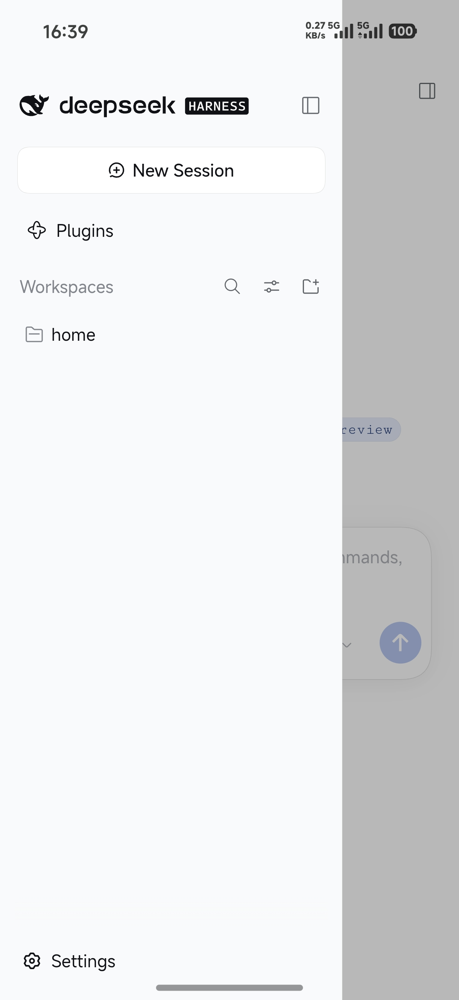

# DSHA

**English** · [简体中文](README.zh-CN.md)

[](https://github.com/Glassous/DSHA/releases)


**DSHA** is a lightweight Android shell for your own DeepSeek Harness (DSH) deployment. You save the service address — plus a username and password if the deployment sits behind Basic auth — and DSHA opens that page in a full-screen WebView, injecting CSS/JS so the desktop-first DSH web UI works properly on a phone.

<p align="center">
  
</p>

## Features

- **Connection profiles** — save any number of DSH addresses. Each one gets an optional name (the host name is used when it is left blank), its own credentials, its own adaptation settings, and a "last opened" timestamp.
- **Basic auth, per connection** — off by default, because DSH itself has no login. Turn it on when the deployment sits behind a reverse proxy such as 1Panel: DSHA fills in the browser sign-in form and retries the first request with an `Authorization: Basic` header.
- **Responsive web adaptation** — restructures the DSH page for phone screens. Each connection declares which DSH version it is adapted for, the adaptation can be switched off entirely (the page then loads untouched), and every connection can pick its own version.
- **A WebView that behaves like an app** — launch animation, safe-area aware edge-to-edge layout, explicit failure states for broken loads and rejected credentials, in-page back handling, and a confirmation before closing. Same-site links stay in the shell; external links and downloads are handed to the system browser and download manager.
- **In-app updates** — checks GitHub Releases on launch (optional) or on demand, renders release notes as Markdown, and can skip a version.
- **Localization** — English and Simplified Chinese. The app follows the system language, and Android 13+ per-app language is supported. First launch walks through the language choice and the user agreement.
- **No baggage** — Jetpack Compose + Material 3, platform APIs only (`SharedPreferences`, `org.json`, `HttpURLConnection`), no analytics, no ads, no DI framework. The manifest declares just `INTERNET` and `POST_NOTIFICATIONS`.

## Requirements

| Item | Value |
| --- | --- |
| Android | 13 (API 33) or newer — `minSdk 33`, `targetSdk 36` |
| Build SDK | Android SDK Platform 37 (`compileSdk 37`) |
| JDK | Gradle toolchain 21, downloaded automatically by the foojay resolver; source/target compatibility is Java 17 |
| Gradle / AGP / Kotlin | Gradle 9.5.0 (wrapper) · AGP 9.3.3 · Kotlin 2.2.10 |
| Network | Only to reach your DSH deployment, plus `api.github.com` for update checks |

## Build and install

```bash
cd android

./gradlew :app:assembleDebug      # -> app/build/outputs/apk/debug/DSHA-v1.0.0-debug.apk
./gradlew :app:assembleRelease    # -> app/build/outputs/apk/release/DSHA-v1.0.0.apk
./gradlew :app:testDebugUnitTest  # unit tests
```

On Windows use `gradlew.bat` instead of `./gradlew`.

- **Release APKs are unsigned.** The project configures no `signingConfigs`, so sign the APK yourself (or add your own signing config) before installing it on a device. Debug builds are signed with the usual debug key.
- The debug build enables WebView remote debugging, so `chrome://inspect` can see the loaded page.
- There is nothing to configure before building: no API keys, no service endpoints, no secrets. The app is pointed at your deployment at runtime, from the connection list.

### Debug and release are two separate apps

The debug build carries its own application ID (`applicationIdSuffix = ".debug"` in `app/build.gradle.kts`) and its own launcher name (overridden in `src/debug/res/`):

| | Release | Debug |
| --- | --- | --- |
| Application ID | `com.glassous.dsha` | `com.glassous.dsha.debug` |
| Launcher name | DSHA | DSHA Debug |
| Signing | none — sign it yourself | the usual debug key |
| WebView remote debugging | off | on — `chrome://inspect` |
| APK | `DSHA-v<version>.apk` | `DSHA-v<version>-debug.apk` |

Because the IDs differ, both builds install side by side on the same device: neither replaces the other, and each keeps its own connection list, settings and user-agreement state. Everything else is shared — the same `versionName`, the same update check, the same code.

## How the page adaptation works

Adaptation is injected in three layers, so version-specific rules never have to fight the generic ones:

| Layer | File | Role |
| --- | --- | --- |
| Base | `ui/web/adapt/BaseAdapt.kt` | Always applied — for every supported DSH version, and even when adaptation is switched off: safe-area padding, shell height-chain fallback (plain web pages included), dialog sizing and centring. |
| Version | `ui/web/adapt/AdaptInjection.kt` | Packages the CSS/JS of the active layers into one script, substitutes tokens such as `__DSHA_SAFE_TOP__` with real values, and runs it with `evaluateJavascript`. |
| Per version | `ui/web/adapt/v020rc2/V020Rc2Adapt.kt` | Component-level CSS/JS for a single DSH release (currently `0.2.0-rc.2`). Rules anchor on class-name suffixes so build hashes do not matter. |

`ui/web/adapt/VersionAdapt.kt` dispatches on the version enum with a `when` that has no `else` branch: add a `HarnessVersion` entry without writing its adaptation and the project stops compiling.

### Adding support for a new DSH version

1. Add the version to `data/HarnessVersion.kt`.
2. Create a package next to `v020rc2/` under `ui/web/adapt/` and put the version's CSS/JS there.
3. Wire it up in `VersionAdapt.kt` — the compiler points at the missing branch.

## Releases and updates

- **The version lives in one place**: `appVersionName` in `android/app/build.gradle.kts`. Bump it, tag the commit `v<the same version>`, publish a GitHub Release — the tag is what the updater compares against the installed `versionName`.
- Version comparison is lenient semver, so `1.0` equals `1.0.0`.
- The build names the artifact `DSHA-v<version>.apk` (`DSHA-v<version>-debug.apk` for debug builds). The updater looks for that exact asset name first, then for any `.apk` asset, then falls back to the release page.
- **Both build types share the version**: `versionName` is deliberately left unsuffixed for debug, because the updater compares it against the release tag. Debug builds are told apart by their application ID, not by their version string.
- **Bilingual release notes**: split the release body into sections with a line containing only `<!-- en -->` or `<!-- zh -->`. The app picks the section matching its interface language and falls back to English when the section is missing.
- Update checks are lenient by design: any network error, 403 or 404 is treated as "no update", so a check never gets in the way.

## Project structure

```
android/
├── app/
│   ├── build.gradle.kts                 # version, build types, SDK levels, dependencies
│   └── src/
│       ├── main/java/com/glassous/dsha/
│       │   ├── MainActivity.kt          # the only Activity: edge-to-edge Compose host
│       │   ├── DshaApplication.kt       # app-scoped repositories
│       │   ├── data/                    # profiles, settings, semver, update check, URL helpers
│       │   ├── ui/nav/                  # route table and transitions
│       │   ├── ui/profile/              # connection list, editor, version picker
│       │   ├── ui/settings/             # settings, language, onboarding, user agreement
│       │   ├── ui/update/               # update state machine, dialog, Markdown renderer
│       │   ├── ui/web/                  # WebView host, loading and error states
│       │   │   └── adapt/               # base layer, version layer, per-version adaptations
│       │   ├── ui/theme/                # colors and typography
│       │   └── ui/transition/           # shared-element transition
│       ├── main/res/                    # strings (English default, values-zh), themes, icons
│       ├── debug/res/                   # debug-only override: app_name → "DSHA Debug"
│       ├── test/                        # JVM unit tests (update checker)
│       └── androidTest/                 # instrumentation test source set
├── gradle/libs.versions.toml            # version catalog
├── gradle/wrapper/                      # Gradle 9.5.0 wrapper
└── settings.gradle.kts
docs/                                    # brand assets and screenshots
```

## Data and privacy

- Connections, settings and the acceptance state of the user agreement live in the app's private `SharedPreferences` as JSON. **Passwords are stored in plain text on the device** — that is deliberate, since they only exist to unlock Basic auth in front of your own deployment. Do not save credentials on a device you do not trust.
- The app itself uploads nothing and contains no analytics, tracking or advertising code. Anything you do inside the loaded page is between you and your deployment.
- The full text is available in the app under **Settings → User agreement**.

## License

Released under the [MIT License](LICENSE).
